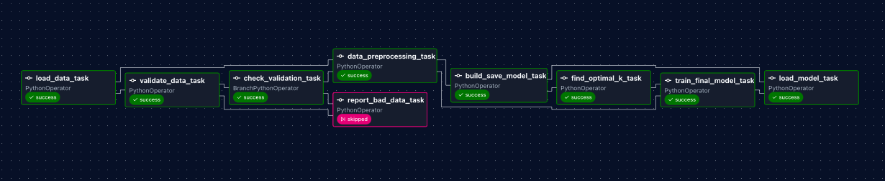
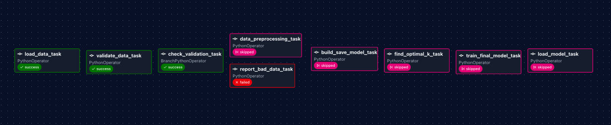

# DADS 7305 Lab 2: Airflow Pipeline with Data Validation and Branching

An Apache Airflow pipeline (a **DAG**) that loads a credit-card customer dataset, **validates it**, **branches** on the result, and then either trains a K-Means clustering model or stops with a report of what was wrong with the data. Everything runs in Docker, so nothing besides Docker needs to be installed.

This project is based on Prof. Ramin Mohammadi's [MLOps Airflow_Labs/Lab_1](https://github.com/raminmohammadi/MLOps/tree/main/Labs/Airflow_Labs/Lab_1). The changes I made to it are listed in [Changes from the original lab](#changes-from-the-original-lab).

**Author:** Connor Rivera · DADS 7305 Machine Learning Operations · Fall 2026



## What the pipeline does

```
load_data_task → validate_data_task → check_validation_task ─┬─ data_preprocessing_task → build_save_model_task → find_optimal_k_task → train_final_model_task → load_model_task
                                                             └─ report_bad_data_task
```

| Task | What it does |
|---|---|
| `load_data_task` | Reads the CSV chosen by the `data_file` parameter (default `file.csv`) from `dags/data/` |
| `validate_data_task` | Checks the data and returns a list of problems (empty list = data is good) |
| `check_validation_task` | **Branch.** No problems → training path. Problems → `report_bad_data_task`. The other path is skipped. |
| `report_bad_data_task` | Prints every problem and fails the run on purpose, without retrying |
| `data_preprocessing_task` | Drops missing rows, keeps `BALANCE`, `PURCHASES`, `CREDIT_LIMIT`, scales them to 0–1, and saves the scaler |
| `build_save_model_task` | Fits K-Means for k = 1 to 49 and returns the error (SSE) for each k |
| `find_optimal_k_task` | Uses the elbow method on the SSE curve to pick k |
| `train_final_model_task` | Trains one K-Means model with the chosen k and saves it as `dags/model/final_model.sav` |
| `load_model_task` | Loads the final model, scales `dags/data/test.csv` with the saved scaler, and predicts its cluster |

## Changes from the original lab

All changes are to the DAG (`dags/airflow.py`), plus the functions it calls in `dags/src/lab.py`.

| # | Change | What it does | Why |
|---|---|---|---|
| 1 | **Data validation task** (`validate_data_task`) | Checks that the 3 required columns exist, there are at least 100 rows, no column is more than 5% missing, and no values are negative | The original trained on whatever was in the file, even broken data |
| 2 | **Branching** (`check_validation_task`, a `BranchPythonOperator`) and **`report_bad_data_task`** | Good data goes down the training path; bad data skips training and fails the run with a list of problems. Uses `AirflowFailException` so bad data is not retried. | A pipeline should decide what to do based on its data, and a bad-data failure should be loud and clear |
| 3 | **`data_file` parameter** and `dags/data/bad_file.csv` | Lets you choose which CSV to load when triggering a run. `bad_file.csv` is a small file that breaks 4 validation rules. | Makes the bad-data path testable |
| 4 | **DAG settings** | Runs every Monday at 06:00 UTC (`schedule='0 6 * * 1'`), retries failed tasks twice with a 1-minute delay, stops any task that runs over 10 minutes, adds tags and an owner | The original only ran by hand and failed on the first error |
| 5 | **Train the final model at the elbow's k** (`find_optimal_k_task`, `train_final_model_task`) | The elbow method's k (8) is passed through XCom to a new task that trains and saves the final model | The original computed the elbow but predicted with the last model in its loop (k = 49) |
| 6 | **Scale test data before predicting** | `data_preprocessing` saves its fitted scaler; `load_model_elbow` uses it on `test.csv` | The original trained on scaled data but predicted on raw data, so the prediction was meaningless |
| 7 | **Airflow 3.3.2 setup** | Uses Airflow's official `docker-compose.yaml` for 3.3.2 with example DAGs turned off and pinned Python packages | The original README pointed to Airflow 2.5.1, which cannot load this DAG's Airflow 3 code |

## Project structure

```
.
├── dags/
│   ├── airflow.py          # The DAG: tasks, branching, schedule, retries
│   ├── data/
│   │   ├── file.csv        # Credit-card customer data (8,950 rows)
│   │   ├── bad_file.csv    # Deliberately broken data for testing the bad-data path
│   │   └── test.csv        # One customer to predict a cluster for
│   └── src/
│       └── lab.py          # Python functions each task calls
├── assets/                 # Screenshots used in this README
├── docker-compose.yaml     # Starts Airflow and its services in Docker
├── setup.sh                # Creates the folders and .env file Airflow needs
└── README.md
```

Folders created when you run the lab (not in the repo): `logs/`, `plugins/`, `config/`, `dags/model/`, and the `.env` file.

## What you need to install

| Software | Version tested | Notes |
|---|---|---|
| [Docker Desktop](https://www.docker.com/products/docker-desktop/) | Docker 29.8.2, Compose v5.6.0 | Any recent version with `docker compose` (Compose v2 or newer) should work. Give Docker at least **4 GB** of memory, ideally 8 GB (Docker Desktop → Settings → Resources). |
| [Git](https://git-scm.com/downloads) | any | To download this repo. Already installed on most Macs. |
| A web browser | any | To use the Airflow web page |

You do **not** need Python or Airflow on your computer. They run inside the Docker containers:

| Inside the containers | Version |
|---|---|
| Apache Airflow (`apache/airflow` image) | 3.3.2 |
| Python | 3.13 |
| pandas / scikit-learn / kneed | 3.0.5 / 1.9.1 / 0.8.6 |
| PostgreSQL (Airflow's database) | 16 |
| Redis (job queue) | 7.2 |

**Windows users:** run the commands below in **WSL** (Windows Subsystem for Linux) or **Git Bash**, because `setup.sh` is a Bash script.

## Setup

Open a terminal and run these steps in order.

**1. Download the repo and go into it**

```bash
git clone https://github.com/connor-rivera/dads7305-lab2-airflow.git
cd dads7305-lab2-airflow
```

**2. Make sure Docker Desktop is open and running.** Its window should say "Engine running".

**3. Run the setup script**

```bash
bash setup.sh
```

This creates the `logs/`, `plugins/`, and `config/` folders and a `.env` file with your user ID, then generates Airflow's config file. The first run downloads the Docker images (over 1 GB) and can take 3–10 minutes. It ends with a long list of Airflow settings.

**4. Set up Airflow's database and login**

```bash
docker compose up airflow-init
```

Wait for the last line: `airflow-init-1 exited with code 0`. (Code 0 means success.)

**5. Start Airflow**

```bash
docker compose up -d
```

Wait 1–2 minutes, then check that everything is up:

```bash
docker compose ps
```

Every service should show `Up ... (healthy)`. If some show `(health: starting)`, wait 30 seconds and check again.

Warnings saying `The "FERNET_KEY" variable is not set` are expected and harmless for a local run.

## Running the pipeline

**1. Open Airflow:** go to <http://localhost:8080> and log in with username `airflow` and password `airflow`.

**2. Turn the DAG on:** click **Dags** in the left sidebar. Find `Airflow_Lab1` and click its toggle so it is no longer paused.

> Because the DAG has a weekly schedule, Airflow may start one **scheduled** run right after you unpause it (for the most recent Monday). That is expected.

**3. Run with good data:** click `Airflow_Lab1`, then **Trigger** (top right). Leave the `data_file` parameter as `file.csv` and confirm.

**4. Run with bad data:** in your terminal (from the repo folder), run:

```bash
docker compose exec airflow-scheduler airflow dags trigger Airflow_Lab1 --conf '{"data_file": "bad_file.csv"}'
```

This starts a run that loads `bad_file.csv` instead of the real data.

To watch a run, click on it and choose the **Graph** view (second icon at the top left). Click any task, then **Logs**, to see its output.

## What a successful run looks like

### Good data (`file.csv`)


- The run is marked **Success**.
- All tasks are green except `report_bad_data_task`, which is **skipped** (pink), because the branch chose the training path.
- Log lines to look for:

| Task | Log line |
|---|---|
| `validate_data_task` | `Validation checked 8950 rows: 0 problem(s) found` |
| `find_optimal_k_task` | `Optimal no. of clusters: 8` |
| `train_final_model_task` | `Saved final 8-cluster model to model/final_model.sav` |
| `load_model_task` | `Loaded model has 8 clusters` and `Returned value was: 6` |

The predicted cluster for `test.csv` is **6**. That customer's credit limit (241,514) is about 8 times the largest in the training data (30,000), so they land in cluster 6, the cluster with the highest credit limits.

### Bad data (`bad_file.csv`)



- The run is marked **Failed**. This is on purpose: the pipeline refused to train on bad data.
- `report_bad_data_task` is **red** and ran only once (no retries). The training tasks are **skipped**.
- The `report_bad_data_task` log lists all 4 problems:

```
Validation problem: Only 3 rows; need at least 100
Validation problem: BALANCE has 1 negative values
Validation problem: PURCHASES has 1 negative values
Validation problem: CREDIT_LIMIT is 33.3% missing; limit is 5%
AirflowFailException: Data failed validation with 4 problem(s); model was not trained
```

## Validation rules

Set at the top of `dags/src/lab.py`:

| Rule | Setting |
|---|---|
| Required columns | `BALANCE`, `PURCHASES`, `CREDIT_LIMIT` |
| Minimum rows | `MIN_ROWS = 100` |
| Most missing values allowed per column | `MAX_MISSING_SHARE = 0.05` (5%) |
| Negative values | Not allowed in any required column |

## Stopping and cleaning up

```bash
docker compose down        # stop Airflow (keeps run history)
docker compose down -v     # stop Airflow and delete its database (full reset)
```

To start again after `docker compose down`, run `docker compose up -d`. After `down -v`, repeat setup steps 3–5.

## Troubleshooting

| Problem | Fix |
|---|---|
| `Airflow_Lab1` is not in the Dags list | Wait 30–60 seconds and refresh. To see errors: `docker compose exec airflow-scheduler airflow dags list-import-errors` |
| `localhost:8080` doesn't load | Check `docker compose ps`. If another program uses port 8080, stop it and run `docker compose up -d` again. |
| Containers keep restarting or show a memory warning | Give Docker more memory in Docker Desktop → Settings → Resources (at least 4 GB). |
| `command not found: docker` | Docker Desktop isn't installed or isn't running. On Mac, if it is running, go to Docker Desktop → Settings → Advanced and choose **System** for the CLI tools. |

## Known limitations

- Python packages are installed with Airflow's `_PIP_ADDITIONAL_REQUIREMENTS` setting, which reinstalls them every time a container starts. Airflow recommends this only for testing; a production setup would build a custom image.
- `build_save_model_task` still saves its last loop model (k = 49) as `dags/model/model.sav`, as in the original lab. The pipeline no longer uses that file; predictions use `final_model.sav`.
- Data is still passed between tasks through XCom as encoded text, as in the original lab. For large datasets, passing file paths would be better.
